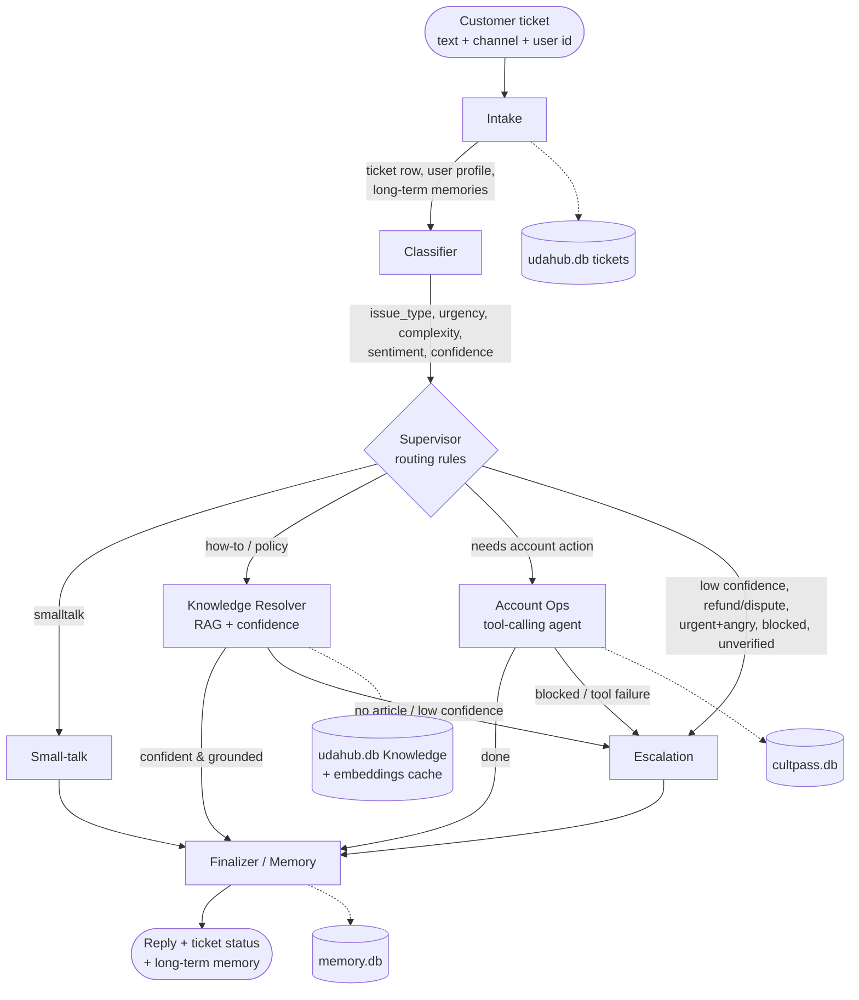

# UDA-Hub Architecture Design

> Location: `agentic/design/architecture.md`. A Mermaid export generated from the *actual compiled graph*
> is in `agentic/design/workflow_graph.mmd` (run `python 04_inspect_state.py`).

## 1. Pattern and rationale
**Supervisor pattern** on LangGraph. A *Supervisor* routes each ticket to exactly one specialised agent.

Why Supervisor (not Network/Hierarchical):
- Support routing must be **auditable and deterministic** (refund = always human). Rules are plain Python over the
  Classifier's structured output, not an LLM guess.
- Specialists never call each other, so failures are isolated and every path is easy to log and test.
- LLMs are used where judgement is needed (classification, grounded answering, tool use), not for control flow.

## 2. Diagram



ASCII version (for viewers without Mermaid):

```
 Ticket(text, channel, user_id)
        |
     [Intake] --(profile, memories, ticket row)--> [Classifier]
                                                        |
                                                  [Supervisor]  (deterministic rules)
        +----------+-----------+------------+-----------+
        |          |           |            |
   smalltalk   knowledge    account_ops   escalation <---------------+
        |          |           |            |                         |
        |      (RAG+conf)   (tools+DB)      |            (no article / low conf /
        |          |           |            |             blocked / tool failure)
        |          +---ok------+            |
        +----------+-----------+------------+
                         |
                  [Finalizer / Memory] --> reply + ticket status + long-term memory
```

## 3. Agent roles and responsibilities
| Agent | File | Responsibility | Reads | Writes (state) |
|---|---|---|---|---|
| Intake | `agentic/agents/intake.py` | Identify customer (CultPass lookup), create/load ticket, store message, recall top-3 long-term memories, reset per-turn fields | `external_user_id`, message | `ticket_id`, `user_profile`, `memory_context` |
| Classifier | `agentic/agents/classifier.py` | LLM structured output: `issue_type`, `urgency`, `complexity`, `sentiment`, `needs_account_action`, `wants_refund_or_dispute`, `confidence` | message, channel, memory | `classification` |
| Supervisor | `agentic/agents/supervisor.py` | Deterministic routing; also hosts the small-talk responder | `classification`, `user_profile` | `route`, `escalation_reason` |
| Knowledge Resolver | `agentic/agents/knowledge_agent.py` | RAG retrieval, grounded answer, confidence scoring, escalation signal | message, memory | `retrieved`, `confidence`, `resolution`, reply |
| Account Ops | `agentic/agents/account_agent.py` | Tool-calling loop over CultPass DB tools; forces authenticated `user_id` into every call | message, profile | `tool_usage`, `resolution`, reply |
| Escalation | `agentic/agents/escalation_agent.py` | 3-bullet human hand-off summary, ticket -> `escalated`, customer-facing message | everything | `resolution=escalated`, reply |
| Finalizer / Memory | `agentic/agents/memory_agent.py` | Persist reply + status; extract and store interaction summary and preferences | full state | long-term memory, ticket status |

## 4. Shared state (`agentic/state.py`)
| Field | Scope | Purpose |
|---|---|---|
| `messages` | session (checkpointed) | Conversation history (reducer appends) |
| `external_user_id`, `channel`, `account_id` | input | Ticket metadata supplied by the caller |
| `ticket_id` | session | = LangGraph `thread_id` |
| `user_profile` | turn | name, found, is_blocked |
| `memory_context` | turn | Recalled long-term memories |
| `classification` | turn | Classifier output |
| `route`, `escalation_reason` | turn | Supervisor decision and why |
| `retrieved`, `confidence` | turn | RAG hits and combined confidence |
| `tool_usage` | turn | Tool name, args, ok, error_code |
| `resolution` | turn | `resolved` / `needs_escalation` / `escalated` |

Intake resets the per-turn fields at the start of each turn; `messages` persists across turns.

## 5. Information and decision flow
**Routing rules (first match wins)**
| # | Condition | Route | `escalation_reason` |
|---|---|---|---|
| 1 | `issue_type == smalltalk` | Small-talk | - |
| 2 | classifier confidence < `CLASSIFIER_MIN_CONFIDENCE` (0.5) | Escalation | `low_classifier_confidence` |
| 3 | refund / chargeback / dispute | Escalation | `refund_or_dispute_requires_human` |
| 4 | urgency high **and** sentiment angry | Escalation | `urgent_and_angry_customer` |
| 5 | needs account action, no authenticated user | Escalation | `identity_unverified` |
| 6 | needs account action, user blocked | Escalation | `user_blocked` |
| 7 | needs account action | Account Ops | - |
| 8 | otherwise | Knowledge Resolver | - |

Metadata used in routing: classification (type, urgency, complexity, sentiment), authenticated user id, blocked flag,
channel and memories (as context). Downstream escalation: Knowledge -> Escalation on `no_relevant_knowledge`,
`low_confidence_kb_answer`, `knowledge_agent_error`; Account Ops -> Escalation on `USER_BLOCKED`, `USER_NOT_FOUND`,
`DB_ERROR`, `tool_loop_exhausted`.

## 6. Inputs and expected outputs
| Input example | Path | Output |
|---|---|---|
| "Hi!" | Small-talk | Short friendly reply |
| "How do I reserve a spot for an event?" | Knowledge Resolver | Grounded answer from KB article |
| "Show my reservations" / "Reserve Samba Night" | Account Ops | Result of DB tool call, explained |
| "I was charged twice, refund now!" | Escalation (rule 3) | Hand-off summary in ticket + polite message |
| Blocked user asks to book | Escalation (rule 6) | "Account under review" message |
| "Best pizza in Lisbon?" | Knowledge -> Escalation | No relevant article, escalated |

### Worked example (trace of "Show my reservations" for Bob)
`Intake` (profile found, 3 memories) -> `Classifier` (reservation, needs_account_action=true, conf 0.95) ->
`Supervisor` (rule 7, route=account_ops) -> `Account Ops` (calls `list_reservations(user_id=f556c0)`, resolved,
conf 0.85) -> `Finalizer` (ticket resolved, interaction memory saved).

## 7. RAG (how retrieval works)
1. `KnowledgeIndex` loads all `Knowledge` rows of the account from `udahub.db`.
2. Text = `title + tags + content` -> OpenAI `text-embedding-3-small`, L2-normalised. Vectors cached in
   `data/core/kb_embeddings.json`, keyed by SHA-256 of the text, so only new/changed articles are re-embedded.
3. Query embedding . article matrix = cosine similarity; top-k (3) returned with scores.
4. **Confidence**: `retrieval_conf = clamp((top_score - 0.25)/0.40)`; `confidence = 0.5*retrieval_conf + 0.5*llm_confidence`.
   - `top_score < 0.30` -> escalate without calling the LLM (`no_relevant_knowledge`)
   - LLM `answerable=false` or `confidence < 0.50` -> escalate (`low_confidence_kb_answer`)
5. The answer prompt restricts the model to retrieved articles and their "Suggested phrasing".

Thresholds are env-configurable (`KB_MIN_SIMILARITY`, `KB_CONFIDENCE_THRESHOLD`).

## 8. Tools (database abstraction)
`agentic/tools/account_tools.py`: `lookup_user`, `get_subscription`, `list_reservations`, `list_experiences`,
`reserve_experience`, `cancel_reservation`. All validate input, hide the ORM, never raise, and return
`{"ok": true, "data": ...}` or `{"ok": false, "error_code", "message"}`. `reserve_experience` checks: blocked,
active subscription, tier vs premium, monthly quota, slots, duplicates.
`agentic/tools/ticket_tools.py` writes tickets/messages/status to `udahub.db`. DB paths are absolute (`agentic/config.py`).
**Security:** Account Ops overwrites any `user_id` argument with the authenticated id, so the LLM cannot act on
another customer's data. The tool functions are self-contained and can be wrapped as an MCP server unchanged.

## 9. Memory
- **Short-term / session**: LangGraph `SqliteSaver` checkpointer, `thread_id = ticket_id`; each turn sends only the new
  message and history is restored.
- **Long-term**: `data/core/memory.db` table `long_term_memory` (interaction summaries + preferences) keyed by
  `external_user_id`, recalled by semantic search at Intake and injected into Classifier, Knowledge and Account prompts.
- **Persistent history**: all messages and status in `udahub.db` (`TicketMessage`, `TicketMetadata`).
- **State inspection**: `04_inspect_state.py` uses `orchestrator.get_state(config)` and
  `orchestrator.get_state_history(config)` to show messages, route, resolution and `tool_usage` for a `thread_id`,
  checkpoint by checkpoint.

## 10. Logging
`logs/agent_events.jsonl`, one JSON object per line: `ts, ticket_id, node, event, ...`. Events: `ticket_received`,
`classification`, `routing_decision`, `kb_answer` / `no_relevant_article`, `tool_call`, `escalated`, `finalized`.
Query with `agentic.logging_utils.search_logs(ticket_id="...", event="routing_decision")` or `jq`.

## 11. Error handling and edge cases
| Failure | Behaviour |
|---|---|
| Classifier/LLM error | confidence 0 -> `low_classifier_confidence` -> escalate |
| Retrieval returns nothing / low score | escalate (`no_relevant_knowledge`) |
| Tool exception / bad args | converted to error dict; DB/identity errors escalate |
| Tool loop does not finish (MAX_STEPS=6) | escalate (`tool_loop_exhausted`) |
| Memory/DB write failure | logged, never crashes the graph |
| No `external_user_id` | account actions escalate; KB questions still work |

Known limitation: identity is passed by the caller; production needs real authentication.

## 12. Tests
`tests/test_tools.py` (no LLM) covers tool validation and error codes. `tests/test_scenarios.py` covers
resolve, escalate, blocked-user and memory scenarios end-to-end.